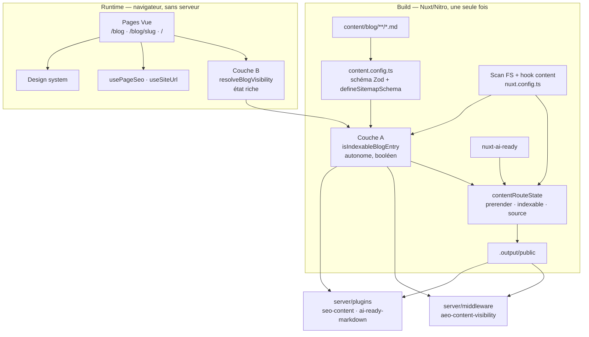
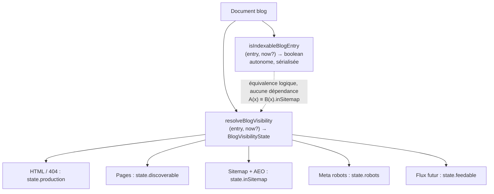
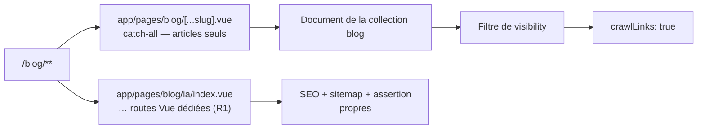
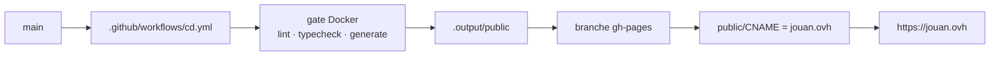

# Architecture — plateforme éditoriale blog

> Ce document comble l'écart bloquant identifié par le readiness check du 2026-09-27 : aucun
> document d'architecture n'existait dans `planning_artifacts`, et `architecture-diagrams.md` ne
> couvre que les flux. Il est **dérivé du code réel** relu le 2026-09-27, pas d'une intention.
> Les numéros de ligne portent sur cet état du dépôt et sont à revalider après evolution.

## 0. Décisions d'architecture

| ID | Décision | Motif | Contrainte |
| --- | --- | --- | --- |
| **AD-01** | Le blog reste un site **statique** sur `@nuxt/content` v3. Aucun CMS, aucune base, aucun serveur à l'exécution. | PRD NFR-1, NFR-2 ; PRD §12. | Interdit tout ajout de dépendance serveur. |
| **AD-02** | `isIndexableBlogEntry` reste **autonome et non sérialisable-importable**. | Elle est passée à `defineSitemapSchema({ filter })` et `@nuxtjs/sitemap` la sérialise via `Function#toString()`. | **Aucune importation, aucune constante externe.** Voir §2. |
| **AD-03** | Le contrat de publication est un **resolver à deux couches** : un prédicat booléen autonome (couche A) et un resolver d'état riche (couche B) qui produit l'état. | La couche A est contrainte par la sérialisation ; la couche B a besoin d'un état structuré que les pages consomment. | **Aucune dépendance entre les deux couches.** Chacune est autonome. > **Amendé le 2026-09-27 (story 16.2 livrée).** Ce tableau disait « couche B **qui le consomme** » et « Dépendance **B → A uniquement** ». C'est matériellement faux : `resolveBlogVisibility` n'appelle **jamais** `isIndexableBlogEntry`, car T3.3 l'interdit — la couche A étant sérialisée, B ne peut ni l'importer ni la déléguer. B duplique donc le test de date verbatim et ne dépend que de `hasNoindexDirective` et `getBlogRobotsDirective`, qui sont des **frères** de A, pas A. `A --> B` du diagramme §4 est de même un graphe de dépendance faux. L'invariant réellement tenu est **l'équivalence logique** `isIndexableBlogEntry(x) ≡ resolveBlogVisibility(x).inSitemap`, à prouver par confrontation des artefacts en 16.7. |
| **AD-04** | `visibility` est le champ qui sépare confidentialité et indexabilité. `noindex` et `sitemap` ne le déduisent pas. | PRD FR-12. | Interdit de déduire un état d'un simple nom de champ. |
| **AD-05** | Le catch-all `/blog/[...slug]` ne porte **que** les articles. Les hubs sont des routes Vue dédiées. | `brownfield.md` §2. | Un slug d'article ne peut être `ia`, `engineering`, `automatisation` sans arbitrage. |
| **AD-06** | Toute relation future est **filtrée avant le rendu**, jamais après. | `crawlLinks: true` (nuxt.config.ts:787) crée une route dès qu'un lien est trouvé dans le HTML. | Voir §5. |
| **AD-07** | Les propriétaires Epic 14 restent uniques. Aucune nouvelle projection AEO, aucun second `head`, sitemap ou robots. | PRD FR-13, FR-14 ; AGENTS.md §9. | Voir §7. |
| **AD-08** | Aucune nouvelle dépendance npm. | `brownfield.md` § Dépendances ; PRD §12. | Un besoin de librairie = décision séparée. |
| **AD-09** | T0 ne crée ni hub, ni related, ni relation projet, ni RSS, ni nouvelle projection AEO. | `brownfield.md` § T0 ; PRD §13.1. | Ces capacités ont chacune leur gate R1. |

## 1. Vue d'ensemble



**Point clé : la couche A est le seul point de vérité de l'indexabilité, et elle est traversée par
neuf appelants indépendants** (§3). Toute divergence entre eux est une fuite de contenu.

## 2. Contrainte structurante — la fonction sérialisée

C'est la contrainte la plus importante du système et elle n'est aujourd'hui documentée que par deux
commentaires de code.

```ts
// content.config.ts:71
filter: isIndexableBlogEntry,
```

```ts
// app/utils/blog-indexability.ts:49-52
 * Cette fonction est volontairement autonome : `@nuxtjs/sitemap` sérialise le
 * callback avec `Function#toString()` dans son module virtuel Nitro. Elle ne doit
 * donc capturer aucune constante ou fonction externe au projet.
```

### 2.1 Conséquences

`isIndexableBlogEntry` est **dupliquée à dessein**. Elle réimplémente inline ce que
`isSitemapExcluded` (ligne 24) et `hasNoindexDirective` (ligne 10) font ailleurs :

| Lignes de `isIndexableBlogEntry` | Duplique | Fonction équivalente |
| --- | --- | --- |
| 94-105 | Test robots + `noindex`/`none` | `hasNoindexDirective` (ligne 10) |
| 106 | `sitemap === false \| "false" \| null` | `isSitemapExcluded` (ligne 24) |

**Cette duplication est une contrainte d'architecture, pas un défaut de code.** La supprimer casse le
sitemap à l'exécution, sans erreur de build.

### 2.2 Le piège du second argument

```ts
// app/utils/blog-indexability.ts:55-58
 * `@nuxtjs/sitemap` applique ce callback via `Array#filter`, qui transmet
 * l'index de l'entrée comme second argument. Ne pas interpréter cet index
 * comme une date
```

Le paramètre `now?: Date` existe **uniquement** comme garde. Un refactor naïf de la forme
`(entry, i) => isIndexableBlogEntry(entry, i)` ferait interpréter un index `0`, `1`, `2`… comme une
date, et exclurait silencieusement des articles-legitimes du sitemap. **Aucune erreur, aucun log** :
seulement des URLs manquantes.

### 2.3 Règles que T0 doit respecter

1. `isIndexableBlogEntry` garde une signature `(entry: unknown, now?: Date) => boolean`.
2. Elle n'importe rien. Elle ne référence aucune constante externe.
3. Elle ne lève pas d'exception : elle retourne `false`. Toute nouvelle entrée inconnue doit
   résulter en état documenté côté couche B, jamais en throw dans la couche A.
4. Toute nouvelle logique d'indexabilité est écrite **deux fois** : inline dans la couche A, et dans
   la couche B. Les deux sont couplées par les fixtures de la story 16.6.

## 3. Les neuf appelants de la couche A

| # | Appelant | Ligne | Rôle | Conséquence d'une divergence |
| --- | --- | --- | --- | --- |
| 1 | `content.config.ts` | 4, 71 | `filter` de `defineSitemapSchema` | Sitemap vía sérialisation — **casse silencieusement** |
| 2 | `nuxt.config.ts` (scan FS) | 3, 436, 445 | `contentRouteState` au scan | Prerender et indexabilité de la route |
| 3 | `nuxt.config.ts` (hook content) | 3, 697, 704 | `contentRouteState` au hook | Idem, second chemin de calcul |
| 4 | `app/pages/blog/index.vue` | 91, 97 | Liste `/blog` | Article exclu listé |
| 5 | `app/pages/blog/[...slug].vue` | 85, 107, 185, 257 | Route article + directive robots | Article exclu rendu, ou robots manquant |
| 6 | `app/pages/index.vue` | 358, 533 | Journal de la homepage | Brouillon visible sur la homepage |
| 7 | `server/plugins/seo-content.ts` | 1, 38, 44 | Réconciliation `sitemap:input` | URL non indexable présente au sitemap |
| 8 | `server/plugins/ai-ready-markdown.ts` | 2, 64 | Nettoyage des exports AEO | Fuite d'un exclu dans `llms-full.txt` |
| 9 | `server/middleware/aeo-content-visibility.ts` | 2, 37 | Refus 404 sur jumeau `.md` | Fuite via l'URL Markdown |

**Neuf appelants, deux chemins de calcul de `contentRouteState`, une seule fonction source.** C'est la
justification structurelle de la story 16.2 : la duplication entre la couche A et la couche B doit
être **détectée par test**, pas par relecture.

### 3.1 Champ `sitemapExcluded` — vestige

`content.config.ts:63` déclare un champ frontmatter `sitemapExcluded`, commenté « Champ interne
overwritten par la transformation ci-dessous ». **Aucune transformation ne l'écrit** : la variable
n'existe que comme locale dans `nuxt.config.ts:442,701` et `blog-indexability.ts:106,108`.

Le champ est donc **mort**. Il ne doit pas être lu par la couche B : la source de vérité est
`isSitemapExcluded(metadata)`, qui lit le champ `sitemap` normalisé. À supprimer en story 16.1.

## 4. Le resolver à deux couches (AD-03)



> **Amendé le 2026-09-27 (story 16.2 livrée).** Deux corrections materialize. L'arête `A --> B`
> était un **graphe de dépendance** et est fausse : B n'appelle jamais A (voir AD-03), la
> duplication du test de date étant la contrepartie obligatoire de la sérialisation. Elle est
> remplacée par une arête en pointillé portant l'invariant réellement tenu, l'équivalence
> logique. Les quatre noms de surface étaient ceux d'une **proposition** que 16.2 a écartée :
> `state.renderable` → `state.production` et `state.robotsDirective` → `state.robots`, les noms
> retenus par §4.1. `USE5` est le champ `feedable`, et non « diffusable sans indexation » : la
> matrice leur donne `✗` pour tout article `noindex` ou `sitemap: false`.

### 4.1 Forme de l'état

**Confirmée en story 16.2 (2026-09-27).** La forme ci-dessous est celle livrée dans
`app/utils/blog-indexability.ts` ; elle ne varie plus.

```ts
type BlogVisibilityState = {
  /** Présent dans le build statique et accessible en HTTP. */
  production: "present" | "absent";
  /**
   * L'article est un artefact public découvrable par un humain.
   * Consommateurs : liste `/blog`, journal de la homepage, CTA de fin d'article (D-09).
   */
  discoverable: boolean;
  /** Présent dans sitemap.xml et les artefacts AEO. */
  inSitemap: boolean;
  /** Directive meta robots à émettre, ou undefined. */
  robots: string | undefined;
  /** État diffusable par un flux futur, sans en créer (FR-15 hors release). */
  feedable: boolean;
};
```

`inSitemap` est le nom retenu plutôt que `indexable` pour ne pas confondre cette couche avec
le champ homonyme de `SeoContentRouteState` (`nuxt.config.ts`), brownfield et renommé hors
périmètre. Le resolver est **total et ne lève jamais** : une entrée nulle, malformée ou inconnue
renvoie l'état le plus restrictif, `production: "absent"`.

`production: "absent"` couvre `draft: true`, date future et `visibility: private` — les trois se
comportent identiquement en T0 (404 direct, preview séparée).

**`discoverable` est le drapeau unique qui gouverne toute exposition à un humain.** Il alimente
déjà la liste `/blog` et le journal de la homepage ; la décision D-09 y rattache le CTA de fin
d'article. **Aucun drapeau `ctaEligible` séparé ne doit être ajouté** : ce serait deux noms pour une
valeur, et un second filtre — précisément ce que la story 16.2 interdit.

### 4.2 Table de correspondance

| État frontmatter | `production` | `discoverable` | `inSitemap` | `robots` | `feedable` |
| --- | --- | --- | --- | --- | --- |
| `draft: true` | absent | ✗ | ✗ | — | ✗ |
| date future | absent | ✗ | ✗ | — | ✗ |
| `visibility: private` | absent | ✗ | ✗ | — | ✗ |
| publié + `noindex: true` | present | ✗ | ✗ | `noindex, nofollow` | ✗ |
| publié + `robots: false` | present | ✗ | ✗ | `noindex, nofollow` | ✗ |
| publié + `sitemap: false/null` | present | ✓ | ✗ | undefined | ✗ |
| publié + indexable | present | ✓ | ✓ | undefined | ✓ |

Cette table est la projection de la matrice PRD §6.3 et de `content-contract.md`. Elle est
**normative** et l'implémentation doit la couvrir par fixtures (story 16.6).

### 4.3 CTA de fin d'article — D-09, tranché le 2026-09-27

Le bloc `.article__cta` a été livré par la story 12.6 (AC-2) et est aujourd'hui inconditionnel.
`getBlogRobotsDirective` (`app/utils/blog-indexability.ts:112-118`) retourne `"noindex, nofollow"`
pour `noindex: true` **et** pour `robots: false` : le CTA y est un lien que les crawlers sont
explicitement invités à ne pas suivre.

**Décision D-09 (arbitrée par Simon) :** le CTA s'affiche **si et seulement si** l'article est un
artefact public découvrable, c'est-à-dire `discoverable === true`.

| État | `discoverable` | CTA |
| --- | --- | --- |
| publié indexable | oui | oui |
| `sitemap: false` / `null` | oui — présent dans les listes | oui |
| `noindex: true` | non | **non** |
| `robots: false` | non | **non** |
| `draft` / futur / `private` | non — pas de HTML | sans objet |
| preview (hors T0) | non par construction | **non** |

**Justification.** L'accroche « Quel process vous fait perdre du temps ? » est une invite à la
conversion qui n'a de sens que si l'article est un artefact public ; `noindex` signifie précisément
le contraire. `sitemap: false` reste un article public listé sur le site : il garde le CTA, seule sa
présence dans le sitemap manque.

**Conséquences assumées :**
- `noindex` est souvent un état de transition (brouillon → revue → publication). Le CTA apparaît et
  disparaît pendant la revue. Accepté.
- Le CTA ne dépend **jamais** du champ `goals` (PRD §6.1 : un `goal` `business` ne modifie ni la
  publication ni la mise en avant d'un lien).
- La condition est lue depuis l'état du resolver. **Aucun filtre local dans le template** : sinon la
  règle « une page n'invente pas son propre filtre » (16.2) est violée.
- La non-régression du contenu livré par 12.6 est vérifiée : eyebrow, titre et libellé inchangés.

**Le header porte par ailleurs un CTA permanent** « Parler de mon besoin » vers `/contact`
(`app/components/HeaderComponent.vue:36` et `:94`). Le CTA de fin d'article est donc un **deuxième**
point de conversion ; D-09 ne le supprime pas, elle en restreint l'exposition. Une suppression
complète reste possible mais casserait un AC livré de l'Epic 12.

**La preview reste hors périmètre T0.** Aucune story ne l'implémente, alors que le PRD (l. 144) exige
que sa politique soit explicite. D-09 donne sa réponse par extension — un brouillon n'étant pas
`discoverable`, sa preview n'afficherait pas le CTA — mais **la construction de la surface de preview
reste une décision R1 non prise**.

## 5. Frontière hubs / catch-all (AD-05, AD-06)



**Le scan ne voit pas les hubs.** `contentRouteState` ne suit que `content/blog/**`
(`nuxt.config.ts:425-450`). Une page Vue de hub doit donc posséder son SEO, son entrée sitemap et son
assertion de présence HTML **explicitement**. Elle ne peut pas hériter de la route article.

**Le crawl précède la visibilité si l'ordre est inversé.** `crawlLinks: true`
(`nuxt.config.ts:787`) suit les liens présents dans le HTML généré. Une relation `related` rendue
sans filtrage préalable crée la route — et un article exclu deviendrait crawlable et donc
potentiellement indexable. Règle : **filtrer, puis rendre**. Jamais l'inverse.

## 6. Couches applicatives

### 6.1 Schéma du contenu — `app/utils/blog-content-contract.ts`

> **Amendé le 2026-09-27 (story 16.1 livrée).** Le schéma ne vit plus dans `content.config.ts` :
> `defineCollection` n'est utilisable qu'une fois le module Content initialisé, donc jamais au
> chargement de la configuration Nuxt, et le contrat doit au contraire y être importable pour
> être exécuté. `content.config.ts` est réduit au câblage : `blog`, `type: "page"`,
> `source: "blog/**"`, `schema: blogContentSchema`. `type: "page"` fournit déjà `title`,
> `description`, `path`, `body`.

**Le schéma doit être typé ET exécuté.** `@nuxt/content` v3 lit `content.config.ts` pour dériver
les colonnes SQLite et les types publics, mais ne valide aucun document : `defineCollection`
appelle `toJSONSchema`, et la boucle d'ingestion (`module.mjs:3301-3305`) transforme toute
exception en `logger.warn("… is ignored because parsing is failed")`. Un point d'application
explicite est donc obligatoire, à deux endroits :

- `scanContentRouteState()` (`nuxt.config.ts`) — le seul échec **dur** : il parcourt le disque au
  chargement de la configuration, avant tout calcul de route, et hors de tout `try/catch`.
- le hook `content:file:afterParse` — rejoue la validation à chaque relecture de fichier, donc
  immédiatement en développement. Son exception n'est **pas** un échec de build.

Champs T0 validés (FR55, story 16.1) : `date` (ISO `YYYY-MM-DD`, calendrier valide),
`updated` (optionnel, `>= date`), `author`, `pillar` (enum fermé), `format` (enum fermé),
`tags` (kebab-case, au moins un), `draft` (**requis**), `visibility`. `title` et `description`
ne sont pas redéclarés dans le schéma (AC 16.1 #1) mais sont contrôlés sur l'entrée brute par
`collectRawFrontmatterIssues`, seule façon de les valider sans les redéclarer.

Gelés, pas retirés : `read` (PRD §12 interdit le *calcul*, pas la valeur ; `reading_time_est` du
JSON-LD en dépend), `image` (rendue par les deux templates et le JSON-LD), `sitemapExcluded`
supprimé comme mort (§3.1). `updatedAt` reste un alias interne dérivé par le hook `content`
pour `nuxt-ai-ready`, et n'est pas une source éditoriale.

Contraintes de validation à préserver :
- `sitemap.loc` et `sitemap.lastmod` sont interdits, dans leurs formes imbriquée **et** pointée —
  le chemin réel de l'entrée Content fait foi, et le `lastmod` est dérivé de `updated ?? date`.
- `publishedAt` est refusé, ainsi que les alias `published`, `pubDate`, `datePublished`,
  `published_date` : `date` est le seul champ de publication.
- `updated >= date` est validé (`.refine`).
- `date` et `updated` valident le format **et** la réalité calendaire (rejet de `2026-02-30`),
  en ne produisant qu'un message par champ.

### 6.2 Pages

> **Amendé le 2026-09-27 (story 16.2 livrée).** La bascule de `/blog` et de la homepage sur
> `discoverable` a été réalisée **dans cette story**, et non en 16.3 / 16.5 : la colonne
> « Listes et homepage » de la matrice normative (§4.2) couvre explicitement la homepage, et
> laisser ces pages sur `isIndexableBlogEntry` aurait créé un second filtre — exactement ce
> qu'AD-03 interdit. 16.3 et 16.5 travaillent donc sur des pages déjà branchées sur le
> resolver ; leur périmètre est la composition éditoriale (promesse, empty state, carte), pas
> le prédicat.

| Route | Rôle | Points d'attention |
| --- | --- | --- |
| `app/pages/blog/index.vue` | Index, promesse, 3 derniers publics, empty state | Filtre sur `state.discoverable` (resolver 16.2) ; la promesse et l'empty state restent à porter en 16.3 |
| `app/pages/blog/[...slug].vue` | Article, `BlogPosting` (l. 210-259), robots (`state.robots`) | Enrichir l'objet existant, **jamais** un second bloc JSON-LD ; CTA à conditionner à `discoverable` en 16.4 (D-09) |
| `app/pages/index.vue` | Journal de 3 articles | Filtre sur `state.discoverable` (resolver 16.2) ; non-régression à prouver en 16.5 |
| `app/pages/about.vue` | `ProfilePage`, auteur canonique | Aucun alias `/a-propos` en T0 |

### 6.3 Design system — composants mobilisés

Aucun composant nouveau. Primitives existantes sous `app/components/ui/`, auto-importées sans
préfixe : `ZCard`, `ZTag`, `ZBadge`, `ZButton`, `ZExternalLink`, `ZAvatar`, `ZIcon`. Images via
`NuxtImg` uniquement. Primitives de layout **globales** (`.section`, `.container`, `.eyebrow`,
`.prose`, `.hero__tags`) dans `app/assets/scss/base/_layout.scss` — à consommer, jamais redéclarer
en `<style scoped>`.

Référence visuelle — **design courant** :
`docs/design_system/ui_kits/jouan-site/Home - Awwwards.html` (cible Awwwards de l'Epic 11), section
`#journal` pour les composants de carte `.jpost` / `.jfeat` / `.jrow` / `.seeall`, et le langage de
section `.block` / `.block__head` / `.container` / `.eyebrow` / `.tag` pour la composition des pages.

⚠️ `ui_kits/jouan-site/Blog.jsx`, `index.html` et `kit.css` appartiennent à la **version précédente
du site** : superseded. Ils ignorent le **monospace des titres** et la taxonomie `.tag` pil. Ne pas
s'en servir comme référence de rendu.

**Aucune page `/blog` ni vue article n'est maquetée dans le design courant**, et le thème clair n'est
couvert par aucune référence (le design est sombre). Ces surfaces sont des **compositions** dérivées
des primitives, validées au navigateur dans les deux thèmes.

### 6.4 Serveur — plugins et middleware

| Fichier | Rôle | Invariant |
| --- | --- | --- |
| `server/plugins/seo-content.ts` | Réconciliation `sitemap:input` | Propriétaire unique. Rejette les non indexables (l. 38) et recalcule `lastmod` (l. 44). |
| `server/plugins/ai-ready-markdown.ts` | Nettoyage des exports AEO | Retire les non publics (l. 64). |
| `server/middleware/aeo-content-visibility.ts` | 404 sur jumeau `.md` exclu | Court-circuite sous `import.meta.prerender` (l. 27) pour laisser la passe se terminer. |

## 7. Propriétaires uniques (AD-07)

| Domaine | Propriétaire | Fichier | Interdit |
| --- | --- | --- | --- |
| Canonical + métadonnées | `usePageSeo()` | `app/composables/usePageSeo.ts` | Second `head`, override SEO imbriqué |
| Origine | `useSiteUrl()` | `app/composables/useSiteUrl.ts` | URL de domaine en dur |
| Profil, compétences, projets | `SITE` | `app/data/site.ts` | Collection auteurs/projets parallèle |
| Indexabilité | Couche A | `app/utils/blog-indexability.ts` | Second prédicat |
| Sitemap / robots | Modules Nuxt SEO + `seo-content.ts` | `nuxt.config.ts`, `server/plugins/` | Second sitemap ou robots |
| AEO | `nuxt-ai-ready` | `nuxt.config.ts` | Nouvelle projection de champ |
| Domaine | `public/CNAME` | `public/CNAME` | Modification du contenu |
| Télémétrie | `useAnalytics()` + `tracking-plan.md` | `docs/specs/spec-analytics-search-console/` | Nouvel événement, propriété ou paramètre |

## 8. Modèle de déploiement (AD-01)



Aucune dépendance serveur à l'exécution. `crawlLinks: true` signifie que **le graphe de liens du HTML
généré définit les routes découvertes** : c'est la raison pour laquelle le filtrage précède le
rendu (§5).

## 9. Stratégie de test

**Aucun framework de test n'est ajouté** (NFR25, PRD FR-17 « hors périmètre »). La validation
repose sur trois piliers existants :

1. **Gate Docker** — `pnpm lint && pnpm typecheck && pnpm generate`, code de sortie `0`.
2. **Assertions CI** existantes sur les artefacts AEO, exclusions, MIME, doublons, liens alternatifs
   et budgets.
3. **Le jeu de 11 fixtures T0** de la story 16.6, qui traverse **chacun** des neuf appelants du §3.

**Conséquence directe de AD-02 :** la duplication couche A / couche B ne peut pas être détectée par
un test unitaire du prédicat, puisque la couche A doit rester non importable. Elle se détecte par
**confrontation des artefacts** — une fixture doit produire le même verdict dans le sitemap, dans le
HTML, dans `llms-full.txt` et dans la liste. C'est le rôle de la story 16.7.

## 10. Traçabilité story → architecture

| Story | Décision(s) / section |
| --- | --- |
| 16.1 contrat + date | §6.1, AD-09, §3.1 (retrait du champ mort) |
| 16.2 resolver | **AD-02, AD-03, §2, §4, §6.2** — la contrainte de sérialisation la gouverne ; `/blog` et la homepage y sont déjà branchés |
| 16.3 `/blog` | §6.2, §6.3, AD-03 (promesse, empty state, carte — le prédicat est livré par 16.2) |
| 16.4 article + `BlogPosting` | §6.2, §7, §4.3 (**D-09**, CTA ⟺ `discoverable`) |
| 16.5 non-régression | §7, §3 (le journal de la homepage consomme déjà la couche B) |
| 16.6 fixtures + gate | §9 |
| 16.7 assertions artefacts | §3, §9 — **seule preuve de cohérence inter-couches** |
| 16.8 revue navigateur | §6.3, §6.4 |
| 17.1 / 17.2 | §8, AD-01 (promotion contrôlée sur l'artefact statique) |

## 11. Limites de ce document

1. **Les numéros de ligne sont ceux de l'état du 2026-09-27** et deviennent faux dès la première
   story. Les symboles et les contrats, eux, sont durables.
2. **La forme exacte de `BlogVisibilityState` (§4.1) était une proposition** — elle a été
   confirmée en story 16.2 le 2026-09-27 et ne varie plus. Ce qui reste normatif est la table de
   correspondance (§4.2).
3. **Aucun composant nouveau n'est spécifié ici.** Si une story en introduit un, ce document doit
   être amendé — sinon il devient faux.
4. **La surface de preview n'est ni spécifiée ni implémentée.** Le PRD exige que sa politique soit
   explicite, aucune story ne la porte, et D-09 n'en règle que le CTA par extension. Décision R1.
5. **Les routes R1 ne sont spécifiées que par leurs contraintes** (§5), pas par leur implémentation.
   Chaque capacité R1 a sa propre gate.
6. **L'alignement UX ↔ Architecture reste partiel** : le design courant ne couvre ni la page `/blog`,
   ni la vue article, ni l'état vide, ni la promesse éditoriale, ni les états de visibility, ni le
   thème clair. Ces surfaces sont des compositions et l'arbitrage visuel revient à Simon.
